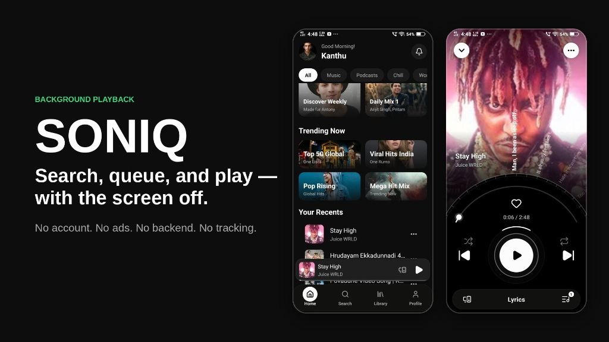

<div align="center">

# SONIQ

**A music player for Android. Search, queue, and play — with the screen off.**

No account. No ads. No backend. No tracking.

[](LICENSE)
[](#download)
[](#tech-stack)
[](https://github.com/lakshmikanthreddy-narla/music-app/releases/latest)

</div>

---

<div align="center">

<a href="https://github.com/lakshmikanthreddy-narla/music-app/releases/latest">
  
</a>

</div>

---

## What it is

SONIQ is a free, open-source music player. You search for a song, tap it, and it plays —
including in the background, with the screen locked, using your phone's normal lock-screen
media controls.

Everything you build up — liked songs, playlists, history, queue, profile and listening
stats — is stored **on your device only**. There is no SONIQ account, no SONIQ server, and
nothing is sent anywhere except the requests needed to search for, stream, and look up
lyrics for the audio you asked for.

## Features

- **Search** — songs, artists, albums and playlists, with artwork and durations
- **Background playback** — keeps playing with the screen off, via a foreground service
- **Lock-screen and notification controls** — control playback without opening the app
- **Now Playing** — full-bleed artwork that changes with every song, a curved disc layout,
  a progress arc, and a like button
- **Synced lyrics** — time-synced lyrics shown while the song plays (looked up from LRCLIB)
- **Queue** — add, remove, reorder, shuffle, and repeat (off / all / one)
- **Add to Queue** — add one song from its menu, or long-press to select several songs and
  add them all at once; queued songs play in the order you added them
- **Library** — liked songs, your own playlists, and imported public playlists
- **History** — what you played, when
- **Resumes where you left off** — queue and playback position survive a restart
- **Next-track preloading** — the following song is prepared in advance for quick starts
- **Profile** — your name, gender, and a profile photo taken with the camera or chosen from
  the gallery
- **Real listening stats** — songs played, time listened today, and artists explored, all
  counted from your own listening and starting at zero
- **Dark, black-and-white design** — a monochrome interface where the artwork supplies the
  colour

## Download

**[⬇ Download SONIQ for Android (APK)](https://github.com/lakshmikanthreddy-narla/music-app/releases/latest)**

<!-- Optional: add the checksum of your APK so people can verify the file.
SHA-256  PASTE-YOUR-SHA256-HERE
-->

Install steps:

1. Open the link above on your Android phone and download the APK.
2. Open the downloaded file. Android will ask you to allow installs from this source
   (your browser or file manager) — allow it for this one install.
3. Tap **Install**, then open **SONIQ**.

SONIQ is **not distributed through Google Play**, so you install it by sideloading. Android
will warn you about installing from an unknown source — that warning is expected for any
APK obtained outside the Play Store. Only install a build you downloaded from this
repository or compiled yourself.

Requires Android 7.0 (API 24) or newer.

### Build the APK yourself on GitHub

1. Open the **Actions** tab of this repository.
2. Choose **Build Android APK** and click **Run workflow** (it also runs on every push to
   `main`).
3. When it finishes (about 15–25 minutes), download the **SONIQ-apk** artifact and unzip it.

Without your own signing key, the workflow signs the APK with the debug key, which installs
fine for personal use but should not be used for public distribution.

## Build from source

**Prerequisites**

- Node.js 20+
- JDK 17 or newer (Android Studio's bundled JBR works)
- Android SDK with platform-tools, and `ANDROID_HOME` set

**Steps**

```bash
git clone https://github.com/lakshmikanthreddy-narla/music-app.git
cd music-app
npm install

# Generate the native Android project (android/ is not committed)
npx expo prebuild --platform android

# Build and install a debug build on a connected device
npm run android
```

SONIQ contains a custom native Android module, so it does **not** run in Expo Go — use the
commands above (or the GitHub Actions build).

To produce a release build with your own signing key, put your credentials in
`credentials/keystore.json` (this file is gitignored and must never be committed) and run
the Gradle release task, or use the **Build Android APK** workflow.

> **Note:** `android/` is generated by `expo prebuild` and is intentionally gitignored, so a
> clean checkout will not contain it. Re-run prebuild after pulling changes that touch native
> configuration.

## Tech stack

| Language | Where it is used |
|---|---|
| **TypeScript / TSX** | The whole app: screens, navigation, hooks, services, playback engine, queue, providers (about 13,000 lines) |
| **Kotlin** | `modules/` — the Android native module that resolves audio streams (about 450 lines) |
| **JavaScript** | Expo config plugins in `plugins/` (ABI list, release signing, core-library desugaring) |
| **Swift** | `modules/` (iOS folder) — a minimal iOS module stub |
| **Gradle** | Android build configuration for the native module |
| **YAML** | GitHub Actions workflow that builds the APK |
| **JSON** | `package.json`, `app.json`, `tsconfig.json`, module configuration |

| Library | Used for |
|---|---|
| React Native `0.86` + React `19` | UI framework |
| Expo SDK `57` (with `expo-dev-client`) | Build tooling and native APIs |
| `expo-audio` | Audio playback, background playback, lock-screen session |
| React Navigation (bottom tabs, native stack) | Navigation |
| `react-native-reanimated` + `react-native-worklets` | Animations |
| `react-native-svg` | Curved Now Playing disc, progress arc and lyric layout |
| `expo-linear-gradient`, `expo-blur` | Gradients and blur |
| `expo-image-picker`, `expo-file-system` | Profile photo from camera or gallery |
| `@react-native-async-storage/async-storage` | On-device storage for library, queue, history and stats |
| `lucide-react-native` | Icons |
| [NewPipe Extractor](https://github.com/TeamNewPipe/NewPipeExtractor) `v0.26.5` | Resolving a playable audio stream (Android, Kotlin) |
| [LRCLIB](https://lrclib.net) | Time-synced lyrics lookup |

## How it works

```
UI  →  MusicService  →  ProviderAdapter  →  TrackResolver  →  PlaybackEngine
```

The layers are deliberately separated so that no screen contains provider-specific logic.
Stream resolution sits behind a small plugin interface:

```
streamResolver = DirectStreamSource → NativeStreamSource → EndpointStreamSource
```

`NativeStreamSource` is an Android-only Kotlin module that resolves a progressive audio
stream on the device. `EndpointStreamSource` lets you point the app at a compatible service
you run or are authorised to use. Adding another source means writing one class that
implements three methods — nothing else in the app changes.

Search and metadata come from the provider layer, queue and shuffle live in
`src/playback/queue.ts`, and the next track is resolved ahead of time by
`src/playback/preload.ts`.

### Project structure

```
App.tsx, index.ts          App entry
src/
  screens/                 Onboarding, Home, Search, Library, PlaylistDetail,
                           NowPlaying, History, Profile (Settings), ProfileSetup
  components/              Common UI, track lists, mini player, queue sheet, lyrics
  navigation/              Root stack and bottom tabs
  playback/                PlaybackEngine, queue, preloader
  providers/               YouTube discovery and stream resolvers
  services/                Music, library, lyrics, stats, toast
  hooks/                   Player, library, search, stats
  core/                    Types, storage, cache, HTTP, errors
  constants/theme.ts       Colours and design tokens
modules/                   Android (Kotlin) native module
plugins/                   Expo config plugins
assets/                    Icons, splash and UI images
.github/workflows/         APK build workflow
```

---

# Legal

Please read this section before using, building, or redistributing SONIQ.

## License

**SONIQ is licensed under the GNU General Public License, version 3 or (at your option) any
later version (GPL-3.0-or-later).** The full license text is in [`LICENSE`](LICENSE); the
project copyright notice is in [`COPYRIGHT`](COPYRIGHT).

```
SONIQ — a music player for Android
Copyright (C) 2026 Sanyam Jain
Modifications Copyright (C) 2026 lakshmikanthreddy-narla

This program is free software: you can redistribute it and/or modify it under the
terms of the GNU General Public License as published by the Free Software Foundation,
either version 3 of the License, or (at your option) any later version.
```

### Why GPL and not a permissive license

SONIQ links the **NewPipe Extractor**, which is GPL-3.0-or-later, and it is built on
GPL-licensed source code. GPL is a copyleft license, so any distributed work that combines
with it must be released under the same terms. SONIQ is therefore GPL-3.0-or-later. This is
the licensing consequence of those components, not a preference.

### What the license means for you

You may **use, study, modify, and redistribute** SONIQ, including commercially. In exchange,
if you distribute SONIQ or any derivative of it — modified or not, as source or as an APK —
you must:

1. License the whole work under GPL-3.0-or-later,
2. Provide or offer the **complete corresponding source code**, including your changes, and
3. Preserve the copyright notices and this license information.

You may **not** relicense SONIQ or any derivative under a permissive or proprietary license,
and you may not distribute a binary without making the matching source available.

### Source code availability

This repository **is** the complete corresponding source for the released APK, as required
by GPL-3.0-or-later §3 and §6. If you received a SONIQ binary from anywhere else and cannot
obtain its source, that redistribution is not compliant with the license.

## Warranty disclaimer

As stated in sections 15 and 16 of the GPL:

> This program is distributed in the hope that it will be useful, but **WITHOUT ANY
> WARRANTY**; without even the implied warranty of **MERCHANTABILITY** or **FITNESS FOR A
> PARTICULAR PURPOSE**. See the GNU General Public License for more details.

You use SONIQ entirely at your own risk. The authors accept no liability for any damages
arising from its use.

## Third-party components

Full notices, versions, and license terms are in
**[`THIRD_PARTY_NOTICES.md`](THIRD_PARTY_NOTICES.md)**. Summary:

| Component | License | How it is used |
|---|---|---|
| Original source code by Sanyam Jain | GPL-3.0-or-later | The codebase SONIQ was modified from |
| [NewPipe Extractor](https://github.com/TeamNewPipe/NewPipeExtractor) `v0.26.5` | GPL-3.0-or-later | Unmodified binary dependency via JitPack |
| nanojson, jsoup | MIT | Transitive, via NewPipe Extractor |
| Mozilla Rhino | MPL-2.0 | Transitive, via NewPipe Extractor |
| Expo, React Native and their ecosystem | MIT | Application framework |

No NewPipe source code has been copied into this repository, and none has been modified.
The NewPipe **application** is not used or bundled — only the extractor library.

## No affiliation or endorsement

- SONIQ is **not affiliated with, authorised by, endorsed by, or sponsored by Google LLC,
  YouTube, or any of their subsidiaries.** "YouTube" and "Google" are trademarks of
  Google LLC. They are referred to here only to describe what the software does
  (nominative use); no claim is made to those marks.
- SONIQ is **not affiliated with Team NewPipe.** NewPipe Extractor is used as an
  independent, unmodified library under its own license, and its authors have no
  involvement in this project.
- SONIQ is **not affiliated with LRCLIB.** It only sends lyric lookup requests to the
  public LRCLIB service.

## No content is hosted or distributed

**SONIQ does not host, store, upload, cache for redistribution, or provide any music,
audio, video, lyrics, or other copyrighted content.** It contains no media library of its
own. The images bundled in `assets/` are used for the interface design only.

SONIQ is a client. It performs the same kind of requests a browser performs, on your
device, at your direction, and plays the result back to you. All content remains with its
original host and its rights holders. No content passes through any infrastructure operated
by the authors.

## Your responsibility as a user

Accessing a third-party service through an unofficial client **may conflict with that
service's terms of service**, and those terms are a matter between you and that service.

By using SONIQ you accept that:

- You are solely responsible for how you use it, and for complying with the terms of
  service of any platform you access through it, as well as with the copyright law and any
  other laws that apply where you live.
- The authors do not encourage or condone copyright infringement.
- SONIQ is published as **free software for personal, educational, and interoperability
  purposes**, and is provided as-is with no warranty of any kind.

If you are unsure whether your intended use is lawful in your jurisdiction, seek your own
legal advice. Nothing in this document is legal advice.

## Privacy

SONIQ has no account system, no analytics, no telemetry, no crash reporting, and no server
operated by the authors.

Liked songs, playlists, history, queue, playback position, listening stats, your profile
(name, gender and photo), and settings are written to your device's local storage and never
leave it. Uninstalling the app removes them. The only network requests SONIQ makes are those
required to fulfil a search, play a track you selected, or fetch lyrics for the song that is
playing (the song title and artist are sent to LRCLIB for that lookup).

## DMCA and contact

If you believe something in **this repository** infringes your rights, please open an issue
or contact the maintainer through GitHub so it can be addressed promptly. Note that this
repository contains source code only — takedown requests concerning media content should be
directed to the platform actually hosting that content, not here.

---

## Contributing

Contributions are welcome. By submitting a pull request you agree that your contribution is
licensed under **GPL-3.0-or-later**, consistent with the rest of the project.

Please keep the existing architecture boundaries intact — in particular, screens should not
contain provider-specific playback logic.

## Credits

Built and maintained by **[lakshmikanthreddy-narla](https://github.com/lakshmikanthreddy-narla)**.

SONIQ was modified from an open-source Android music player originally written by
**[Sanyam Jain](https://github.com/SJbuilds04)** and released under GPL-3.0-or-later.
That license and the original copyright notice are preserved in this repository.

Stream resolution is powered by the excellent
[NewPipe Extractor](https://github.com/TeamNewPipe/NewPipeExtractor) by Team NewPipe, and
synced lyrics come from [LRCLIB](https://lrclib.net).

<div align="center">

**LISTEN FREELY. LIVE FULLY.**

</div>